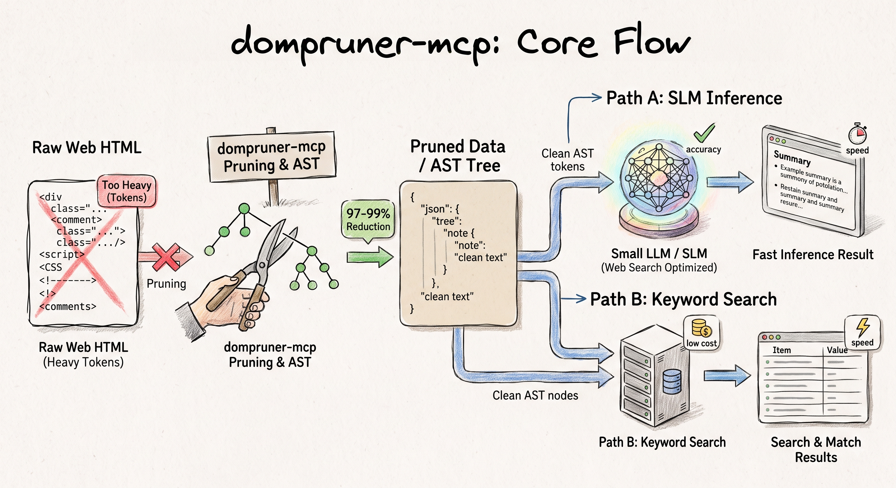

# dompruner-mcp

English | [한국어](./README.ko.md)



> LLM 웹 파이프라인을 위한 DOM AST 미들웨어 — 레이아웃 노이즈(nav·스크립트·사이드바)를 제거하고 원문을 그대로 전달합니다. query를 넘기면 BM25로 관련 섹션만 추가 필터링합니다.

LLM이 웹 fetch 툴을 사용하면 원시 HTML이 텍스트로 변환되어 모델 컨텍스트에 그대로 들어옵니다 — navigation·사이드바·보일러플레이트를 포함한 수만 토큰이 불필요하게 쌓입니다. DomPruner는 DOM 수준에서 이를 제거하고 **원문 콘텐츠만 모델에 직접 전달**합니다.

| 호출 | 동작 |
|---|---|
| `dompruner_fetch(url)` | 레이아웃 노이즈 제거 → 전체 추출 콘텐츠 반환 |
| `dompruner_fetch(url, query)` | 레이아웃 노이즈 제거 → BM25로 관련 섹션만 (매칭 없으면 전체 반환) |

```
> [DomPruner] docs.python.org
> | Raw HTML  | 44,316 tokens |
> | DomPruner |  1,328 tokens |
> | 절감      |        97.0%  |
> Fetch: 194ms · Parse: 11.2ms
```

**WebFetch 대비 평균 93.5% 토큰 절감. 응답 속도 45% 향상.**
→ [전체 벤치마크](https://github.com/dong7812/dompruner-mcp/blob/main/docs/benchmark.md)

---

## 빠른 시작

설치 없이, API 키 없이:

```bash
npx -y dompruner-mcp
```

### Claude Code

```json
{
  "mcpServers": {
    "dompruner": {
      "type": "stdio",
      "command": "npx",
      "args": ["-y", "dompruner-mcp"]
    }
  }
}
```

프로젝트 루트의 `.mcp.json` 또는 전역 설정 `~/.claude/.mcp.json`에 추가. `/mcp`로 확인.

### Claude Desktop

`~/Library/Application Support/Claude/claude_desktop_config.json` (macOS) 또는 `%APPDATA%\Claude\claude_desktop_config.json` (Windows) 편집:

```json
{
  "mcpServers": {
    "dompruner": {
      "command": "npx",
      "args": ["-y", "dompruner-mcp"]
    }
  }
}
```

### Cursor / Windsurf / 기타 MCP 클라이언트

```json
{
  "mcpServers": {
    "dompruner": {
      "type": "stdio",
      "command": "npx",
      "args": ["-y", "dompruner-mcp"]
    }
  }
}
```

### Remote HTTP (설치 불필요, 항상 최신)

HTTP transport를 지원하는 클라이언트라면 Node.js 설치 없이 바로 사용 가능하며, 배포 시마다 자동으로 최신 버전이 적용됩니다:

```json
{
  "mcpServers": {
    "dompruner": {
      "url": "https://dompruner-mcp.vercel.app/api/mcp"
    }
  }
}
```

### LangChain / LangGraph

[`langchain-mcp-adapters`](https://pypi.org/project/langchain-mcp-adapters/)로 MCP stdio 서버를 LangChain 툴로 자동 변환:

```python
from langchain_mcp_adapters.client import MultiServerMCPClient

client = MultiServerMCPClient({
    "dompruner": {
        "command": "npx",
        "args": ["-y", "dompruner-mcp"],
        "transport": "stdio",
    }
})
tools = await client.get_tools()
```

### AI가 항상 DomPruner를 사용하도록 설정

툴 설명에 WebFetch 대신 `dompruner_fetch`를 우선 사용하도록 지시가 포함되어 있습니다. 그래도 내장 fetch로 폴백된다면 클라이언트의 지시 파일에 아래 규칙을 추가하세요:

```markdown
URL을 가져올 때 WebFetch 대신 항상 dompruner_fetch를 사용하세요.
- URL 알고 있으면 → dompruner_fetch(url, query?)
- URL 모르면 → 먼저 검색으로 URL을 찾고, dompruner_fetch(url) 호출
```

| 클라이언트 | 지시 파일 |
|--------|-----------------|
| Claude Code | `CLAUDE.md` (프로젝트) 또는 `~/.claude/CLAUDE.md` (전역) |
| Cursor | `.cursorrules` |
| Windsurf | `.windsurfrules` |
| Cline | `.clinerules` |
| GitHub Copilot | `.github/copilot-instructions.md` |

---

## 툴

| 툴 | 설명 |
|------|-------------|
| `dompruner_fetch` | URL → DOM 정제 Markdown. `query` 옵션으로 BM25+ 섹션 필터 활성화. |
| `dompruner_sitemap` | sitemap.xml의 모든 페이지 → 정제된 Document. |
| `dompruner_analyze` | 전체 콘텐츠 없이 토큰 절감 리포트만 반환. |

→ **[툴 레퍼런스](https://github.com/dong7812/dompruner-mcp/blob/main/docs/tools.md)**

---

## 벤치마크 요약

### WebFetch 비교 (라이브 측정, Claude Haiku)

Anthropic의 `web_fetch_20260209` 서버 툴로 동일 조건(모델·시스템 프롬프트·툴 정의 동일)에서 측정. → [전체 방법론](https://github.com/dong7812/dompruner-mcp/blob/main/docs/benchmark.md)

| 지표 | `web_fetch` 툴 | **DomPruner** |
|---|:---:|:---:|
| 평균 컨텍스트 토큰 | ~15,735 | **~1,019 (93.5% 절감)** |
| 답변 품질 (10개 쿼리) | 9 / 10 | **8 / 10** |
| 평균 응답 시간 | 5,811 ms | **3,168 ms (45% 빠름)** |
| 콘텐츠 충실도 | 원시 페이지 콘텐츠 (HTML → 텍스트 변환) | **DOM 추출 원문** |
| 추가 API 키 / 인프라 | 없음 | **없음** |

### BM25 섹션 선택 정확도 (스냅샷 기반 결정적 측정)

| 평가셋 | 페이지 수 | 평균 절감율 | 섹션 보존율 |
|---|:---:|:---:|:---:|
| 튜닝셋 (MDN, docs.python.org) | 10 | 98.0% | **98.0%** |
| **검증셋 (미사용 사이트)** | 5 | 98.7% | **96.0%** |

headingBoost=2.0은 튜닝셋에서 파라미터 스윕(1.0–3.0)으로 선정됐습니다. 검증셋은 튜닝에 쓰이지 않은 5개 사이트(react.dev, typescriptlang.org, expressjs.com, doc.rust-lang.org, nextjs.org)로 구성해 과적합 여부를 확인했습니다. 2%p 차이는 알려진 heading-bias 한계 범위 내에 있습니다.

→ **[전체 벤치마크](https://github.com/dong7812/dompruner-mcp/blob/main/docs/benchmark.md)** · **[아키텍처](https://github.com/dong7812/dompruner-mcp/blob/main/docs/architecture.md)**

---

## Crawl4AI 비교

Crawl4AI는 크롤러 프레임워크 — 브라우저 자동화, JS 렌더링, 클릭·스크롤 인터랙션, JSON 추출, 심층 크롤. DomPruner는 LLM 컨텍스트 미들웨어 — 에이전트가 URL을 이미 알고 있을 때 토큰 비용을 줄이는 단일 목적 레이어입니다.

**해결하는 문제가 다릅니다.** 하지만 MCP 에이전트 안에서 웹 페이지를 읽는 용도로 둘 다 쓸 수 있으므로 비교는 유의미합니다.

### 설치

| | Crawl4AI | **DomPruner** |
|---|:---:|:---:|
| 설치 | `pip install crawl4ai && crawl4ai-setup` (Chromium ~300 MB) | **`npx -y dompruner-mcp`** |
| 브라우저 필요 여부 | 기본 설치에 Chromium 포함 (HTTP 전용 모드 있음) | **없음** (SSR; CSR 감지 시 Playwright만 사용) |
| MCP 서버 | Crawl4AI Docker 서버 실행 필요 | **`npx -y dompruner-mcp` — 별도 서버 없음** |
| 토큰 필터 설정 | 코드에서 필터 객체 생성 (`BM25ContentFilter(user_query=...)`) | **불필요 — `query=`만 넘기면 됨** |

### 검증셋: DomPruner 튜닝에 쓰지 않은 5개 사이트

가장 방어하기 쉬운 비교: DomPruner 파라미터 튜닝에 사용하지 않은 사이트 5개(react.dev, typescriptlang.org, expressjs.com, doc.rust-lang.org, nextjs.org). 두 툴 모두 동일 쿼리 사용.

| 페이지 | C4AI BM25ContentFilter | **DomPruner** |
|------|:---:|:---:|
| React useEffect | 4,275 | **1,257** |
| TypeScript narrowing | 2,782 | **1,214** |
| Express routing | 1,938 | **1,799** |
| Rust ownership | 1,832 | **718** |
| Next.js layouts | 1,505 | **1,379** |
| **합계** | **12,332** | **6,367** |
| **정확도** | **96%** | **96%** |

**DomPruner가 튜닝하지 않은 사이트에서도 1.9배 적은 토큰으로 동일 정확도(96%).**

### 참고: 튜닝셋 10개 페이지 (MDN, docs.python.org)

DomPruner의 튜닝 페이지에서 Crawl4AI `PruningContentFilter` 대비: **13.2배 작고 8%p 더 정확** (90% → 98%). 동일 쿼리로 `BM25ContentFilter`를 적용하면 10개 중 5개에서 거의 빈 결과 — `<dl>/<dt>/<dd>` 정의 목록 구조 페이지에서 threshold 스윕(0.0~0.10) 시 0.01에서 절벽이 나타나며 중간 최적값이 존재하지 않는 구조적 문제입니다.

→ **[전체 비교 표·threshold 스윕 데이터](https://github.com/dong7812/dompruner-mcp/blob/main/docs/benchmark.md#5-vs-crawl4ai)**

---

## 관련 프로젝트

- **[dompruner-py](https://github.com/dong7812/dompruner-py)** — Python 포트. LangChain용 `DomPrunerLoader`, `DomPrunerSitemapLoader`, `DomPrunerFetchTool`. `pip install dompruner`.
- **[LangChain 통합 목록](https://docs.langchain.com/oss/python/integrations/document_loaders)** — dompruner-py가 서드파티 웹 로더로 등재.

---

## 라이선스

MIT
